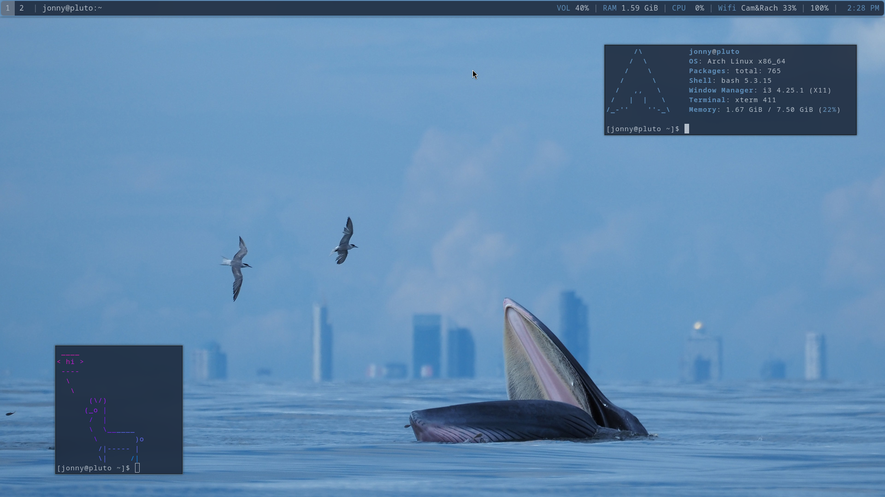
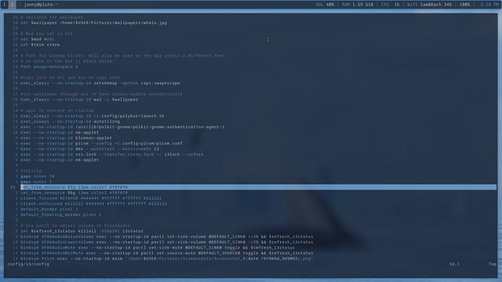
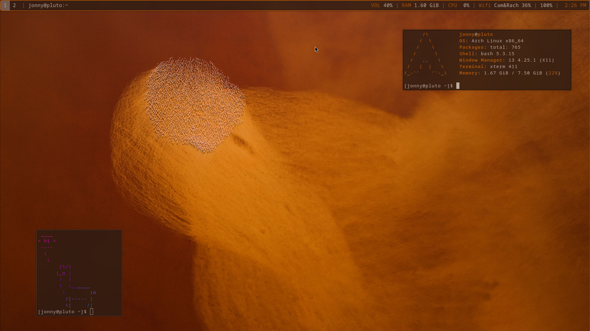
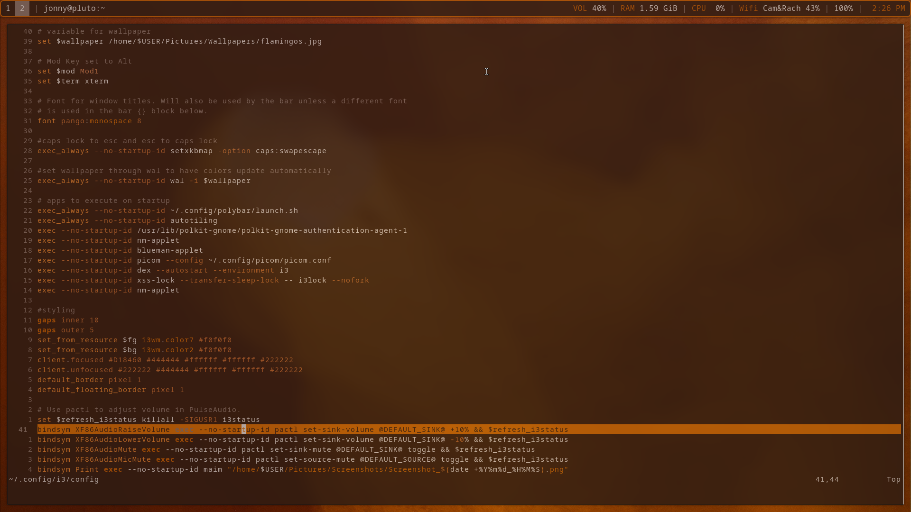

# Dotfiles for my Linux rice
I installed Arch Linux on my laptop in June 2026 and I've added my own customizations as I've gone. The main philosophy of my set up is to add things as I need them, there's no point in downloading/configuring something I don't use. I've started with the basic config files of the packages I use slowly modifying them how I like them. Recently (around November 2026) I've been wanting to migrate the same setup to a different machine, so that's why I've made this repo

## Visuals:

## How It's Made:
To actually make it into a repo I was originally just going to do symlinks but after further reading I decided on a different method. I found a post written by durdn (linked below) that had a much more elegant method which taught me even more about Git! The basics of it is just that you create a bare repository and use your home directory as the working tree. All the weird quirks of it are mostly solved by durdn, so if you have more questions I recommend reading it.

The core of the setup is i3 as the window manager and Arch Linux as the OS. I used i3 because I hadn't heard of Sway (I'll migrate eventually) and I originally installed KDE Plasma but I wanted something more lightweight and keyboard driven that had better support for tiling windows. I realized if I just switched DEs I'd get exactly what I wanted, so I did. Then I wanted to change my wallpaper a lot and needed something to change my colorscheme to match so I downloaded pywal16 to get all of the colors to automatically switch.

**Link to durdn's post:** https://www.atlassian.com/git/tutorials/dotfiles

## All packages
Operating System: Arch Linux
Display Server: X11
Desktop Environment/Window Manager: i3wm
Terminal: Xterm
Status bar: Polybar
Compositor: Picom
Text Editor/IDE: Neovim
Display Manager: Don't need it
Notification Mananger: Dunst
Shell: Bash
Themes/Colors: Pywal16
**The rest of my packages**
 - under construction here lol

I also installed some fonts I needed for school (Times New Roman) that are in this repo at .local/share/fonts

## How to install onto a new system
Read the linked post! He describes it very well already so I'm not going to go through the trouble of putting it into my own words here.
