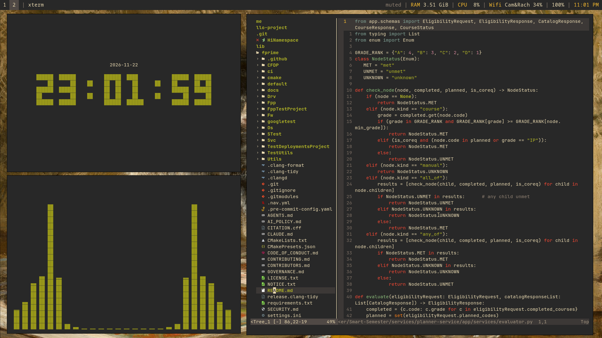
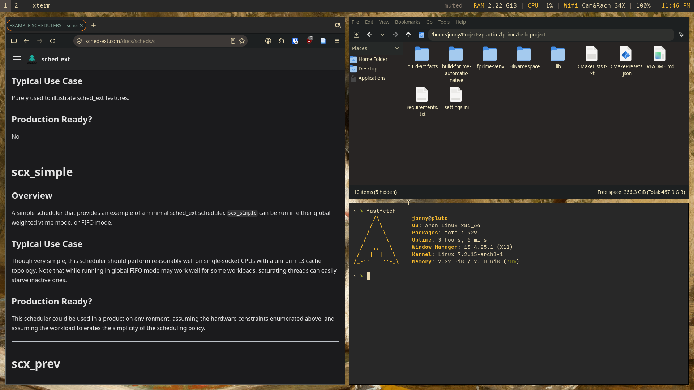
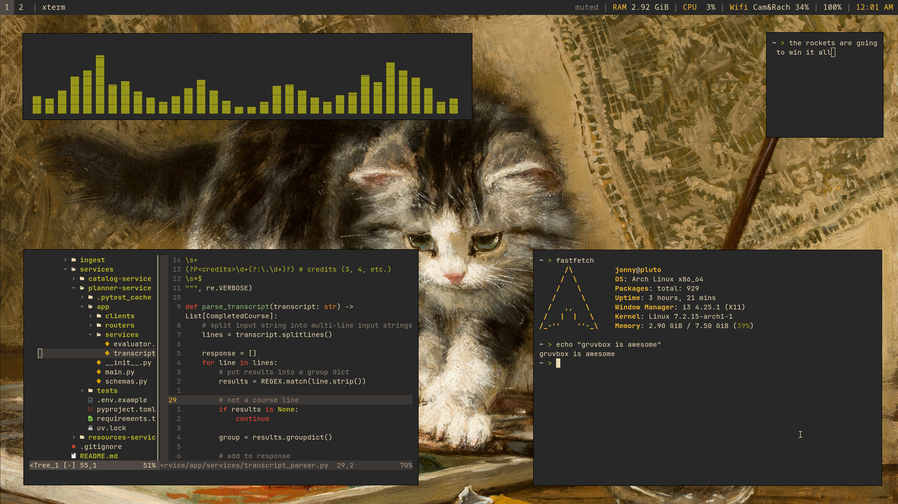

# Dotfiles for my Linux rice
I installed Linux on my laptop in June 2026 and I've added my own customizations as I've gone. The main philosophy of my set up is to add things as I need them, there's no point in downloading/configuring something I don't use. I've started with the basic config files of the packages I use slowly modifying them how I like them. Recently (around November 2026) I've been wanting to migrate the same setup to a different machine, so that's why I've made this repo

## Visuals:

## How It's Made:
To actually make it into a repo I was originally just going to do symlinks but after further reading I decided on a different method. I found a post written by durdn (linked below) that had a much more elegant method which taught me even more about Git! The basics of it is just that you create a bare repository and use your home directory as the working tree. All the weird quirks of it are mostly solved by durdn, so if you have more questions I recommend reading it.

**Link to durdn's post:** https://www.atlassian.com/git/tutorials/dotfiles

The core of the setup is sway as the window manager and Arch Linux as the OS. I used i3 because I hadn't heard of Sway and I originally installed KDE Plasma but I wanted something more lightweight and keyboard driven that had better support for tiling windows. I realized if I just switched DEs I'd get exactly what I wanted, so I did. Then I wanted to change my wallpaper a lot and needed something to change my colorscheme to match so I downloaded pywal16 to get all of the colors to automatically switch. After a while of i3 + pywal16 I wanted to migrate to Wayland as it has more support and is just better than X11, the weird colorschemes of pywal were also making my eyes hurt with extended use so I just changed everything to Gruvbox.

#### In the future
I enjoy minimalist setups visually but it doesn't mean I won't add anything heavy if it looks real nice. I want to move by bar to the side and add quickshell everywhere just to make it pop a little more. One big caveat is that I still want it to be keyboard driven otherwise I'm not doing this.

## All packages
- Operating System: [Arch Linux](https://wiki.archlinux.org/title/Installation_guide)
- Display Server: Wayland
- Desktop Environment/Window Manager: [sway](https://github.com/swaywm/sway)
- Terminal: Foot
- Status bar: Waybar
- Text Editor/IDE: Neovim
- Display Manager: Don't need it
- Notification Mananger: Dunst
- Shell: Bash
- Themes/Colors: Gruvbox  

All of the required packages are [here](./.config/packages/base.txt), optional packages that I use often are [here](./.config/packages/optional.txt)

I also installed some fonts I needed for school (Times New Roman) that are [here](./.local/share/fonts)

## How to install onto a new system
Read the linked post! He describes it very well already so I'm not going to go through the trouble of putting it into my own words here.
